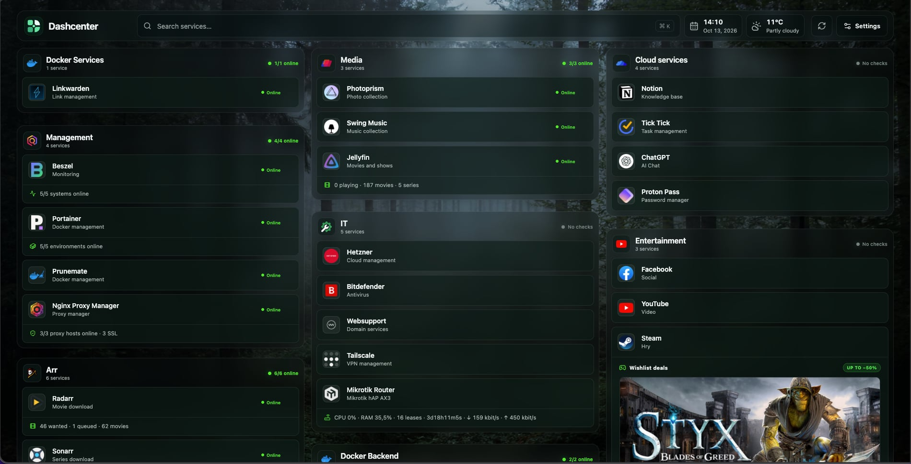

  

# Dashcenter

**Current release: v1.0.6**

Dashcenter is a self-hosted start page and service dashboard managed from the browser. It combines links, service status, Docker metadata, native service integrations and flexible widgets in one responsive board without requiring users to maintain YAML for everyday changes.

Dashcenter is an independent project inspired by the clarity of Homepage. It is not affiliated with, endorsed by, or maintained by Homepage or its maintainers.

## Preview

*Example of a customized Dashcenter installation.*

## Highlights

- Browser-based setup and administration
- One measured responsive board for service groups and dashboard widgets, without overlap or empty full-row bands
- Direct layout editing on the real dashboard with stable drag-and-drop, resize handles, Undo/Redo and exact position controls
- Three-pane service administration with searchable groups and services, focused plugin forms and live dashboard-card previews
- Responsive multi-column or single-column service rows for every group, with full-width native plugin content
- Versioned Forest, Graphite, Nord and Warm appearance presets with semantic color, surface, type, motion and icon controls
- Compact top-bar modules for search, time, weather, host resources and service availability
- Dashboard cards for server health, service health, Jellyfin/Plex activity, MikroTik network traffic, Docker status, calendars, merged RSS/Atom feeds and custom JSON APIs
- Native service plugins for Beszel, Portainer, Proxmox VE, Uptime Kuma, Jellyfin, Plex, MikroTik, Radarr, Sonarr, Lidarr, Prowlarr, Bazarr, qBittorrent, Nginx Proxy Manager and Steam wishlist deals
- Homepage-compatible service import and export
- SQLite persistence, automatic revisions and JSON backup/restore
- Server-side credential storage, first-run choice of an empty or generic demo board, and optional sign-in for dashboard viewing

## Choose a deployment method

| Method | Best for | Docker metadata |
| --- | --- | --- |
| Docker Compose (GHCR images) | Most self-hosted installations | Included through the restricted metadata gateway |
| Portainer Stack (Web editor) | GUI-managed Docker environments | Included through the same restricted gateway |
| Dashboard-only container | Hosts that do not need local Docker discovery | Disabled unless an external connection is added |
| Build from source | Development and custom images | Included through the restricted metadata gateway |
| Node.js from source | Development and contributions | Optional |

All deployment methods use the same application and **/data** layout. Docker discovery is optional; links, widgets and native HTTP integrations continue to work without it.

## Access and privacy

The first-run setup lets the administrator choose an empty board or a small generic demo board. New installations have no preconfigured Docker connection. Existing dashboards and the data volume keep their saved content during an update.

By default, anyone who can reach Dashcenter can view the published dashboard, groups marked **Everyone**, and data shown by enabled widgets and plugins. In **Settings → Dashboard**, enable **Require sign-in to view** to require an account for all dashboard data and uploaded images. This release uses the existing administrator account for viewing; it does not add a separate viewer role. Group visibility in **Settings → Services** can be **Everyone**, **Signed-in only**, or **Hidden**. Signed-in groups are omitted from anonymous dashboard and plugin responses. Hidden groups stay off the board even when signed in. Keep sensitive information out of names, links and widgets that you choose to publish.

Disabled widgets, private feed URLs, provider credentials and Docker connection endpoints are excluded from anonymous dashboard responses. An RSS/Atom feed widget can combine up to five saved URLs, sorted by date with the source name on each item; feed URLs remain stored on the server.

Complete the first-run administrator setup on a trusted network before making the dashboard reachable from the internet. Failed logins are temporarily throttled, and signed-in image uploads share a limit of 12 requests per account per minute across all upload forms. Internet-facing installations should also use HTTPS and a trusted reverse proxy. JSON configuration backups omit server-side credentials and uploaded files, but they still contain service links and internal connection settings; store them privately.

## Requirements

For container deployments:

- Docker Engine with Docker Compose v2, Portainer or another OCI-compatible runtime
- A persistent volume or directory mounted at **/data**
- One available host port
- HTTPS through a trusted reverse proxy for internet-facing installations, or a trusted LAN/VPN for HTTP-only access

For source development, use Node.js 24 or newer and pnpm 11.

## Docker Compose with published images

The [GHCR Compose file](compose.ghcr.yml) runs the published Dashcenter and restricted Docker metadata gateway images. Download it and create the persistent data volume before the first start:

~~~bash
curl -fsSLo compose.yml https://raw.githubusercontent.com/diabloduvi-ops/Dashcenter/main/compose.ghcr.yml
docker volume create dashcenter_data
docker compose -f compose.yml config
docker compose -f compose.yml up -d
docker compose -f compose.yml ps
~~~

The default port is **3000** on a trusted HTTP LAN or VPN. To change the port, timezone, or proxy settings, put a **.env** file beside **compose.yml**:

~~~dotenv
DASHCENTER_PORT=3000
TZ=Europe/Bratislava
TRUST_PROXY=false
SESSION_COOKIE_SECURE=false
~~~

For an HTTPS reverse proxy, set **TRUST_PROXY** to that proxy's IP address or CIDR range and set **SESSION_COOKIE_SECURE=true**. Open **http://your-server:3000**, or the hostname configured in your reverse proxy. The first visitor creates the administrator account.

The stack runs **dashboard**, **dockerproxy**, and the external named volume **dashcenter_data**. Keep the same volume name when updating or changing deployment methods.

## Portainer Stack (Web editor)

Create the volume **dashcenter_data** under **Volumes** if this is a new installation. For an existing installation, reuse its volume and edit its current stack. In **Stacks → Add stack → Web editor**, paste the following Compose definition. Set **DASHCENTER_PORT**, **TZ**, **TRUST_PROXY**, and **SESSION_COOKIE_SECURE** in the stack environment if you need values other than the defaults.

~~~yaml
name: dashcenter

services:
  dashboard:
    image: ghcr.io/diabloduvi-ops/dashcenter:latest
    pull_policy: always
    container_name: dashcenter
    restart: unless-stopped
    ports:
      - "${DASHCENTER_PORT:-3000}:3000"
    environment:
      TZ: ${TZ:-UTC}
      DATA_DIR: /data
      PORT: "3000"
      TRUST_PROXY: "${TRUST_PROXY:-false}"
      SESSION_COOKIE_SECURE: "${SESSION_COOKIE_SECURE:-false}"
    volumes:
      - dashcenter_data:/data
    read_only: true
    tmpfs:
      - /tmp:size=64m,mode=1777
    security_opt:
      - no-new-privileges:true
    cap_drop:
      - ALL
    depends_on:
      dockerproxy:
        condition: service_started
    healthcheck:
      test: ["CMD", "node", "-e", "fetch('http://127.0.0.1:3000/api/healthz').then(r=>{if(!r.ok)process.exit(1)}).catch(()=>process.exit(1))"]
      interval: 30s
      timeout: 5s
      retries: 3
      start_period: 15s

  dockerproxy:
    image: ghcr.io/diabloduvi-ops/dashcenter-docker-proxy:latest
    pull_policy: always
    container_name: dashcenter-docker-proxy
    restart: unless-stopped
    environment:
      DISABLE_IPV6: "1"
      LOG_LEVEL: warning
    volumes:
      - /var/run/docker.sock:/var/run/docker.sock:ro
    read_only: true
    tmpfs:
      - /run
      - /tmp
    security_opt:
      - no-new-privileges:true
    cap_drop:
      - ALL

volumes:
  dashcenter_data:
    external: true
    name: dashcenter_data
~~~

The same definition is kept in [compose.ghcr.yml](compose.ghcr.yml). **pull_policy: always** pulls the current image when Compose redeploys the stack. Existing installations should keep their **dashcenter_data** volume mounted at **/data**.

Behind HTTPS, set **TRUST_PROXY** to the trusted proxy's IP address or CIDR range and **SESSION_COOKIE_SECURE=true**. Leave **TRUST_PROXY=false** on direct connections. Use **SESSION_COOKIE_SECURE=false** only on a trusted HTTP LAN or VPN.

## Build from source

The root [docker-compose.yml](docker-compose.yml) builds both images from the repository. It is used for source development and CI:

~~~bash
git clone https://github.com/diabloduvi-ops/Dashcenter.git
cd Dashcenter
cp .env.example .env
docker compose config
DASHCENTER_REVISION="$(git rev-parse HEAD)" docker compose up -d --build
docker compose ps
~~~

Set the proxy and cookie values in **.env** for your HTTP or HTTPS setup. To run only Dashcenter without its local Docker metadata gateway, use **docker compose up -d --build --no-deps dashboard**.

## Dashboard-only container

Run the published application image directly when you manage networking, reverse proxying or monitoring elsewhere:

~~~bash
docker volume create dashcenter_data
docker run -d \
  --name dashcenter \
  --restart unless-stopped \
  --read-only \
  --tmpfs /tmp:size=64m,mode=1777 \
  --security-opt no-new-privileges:true \
  --cap-drop ALL \
  -p 3000:3000 \
  -e DATA_DIR=/data \
  -e PORT=3000 \
  -e TZ=UTC \
  -e TRUST_PROXY=false \
  -e SESSION_COOKIE_SECURE=false \
  -v dashcenter_data:/data \
  ghcr.io/diabloduvi-ops/dashcenter:latest
~~~

Adapt the cookie and proxy settings before exposing the container through HTTPS. Docker-backed service status and discovery require a reachable Docker API connection; every other feature remains usable.

## Docker metadata connections

The bundled gateway is available inside the Compose network at **http://dockerproxy:2375**. Add it under **Settings → Connections → Docker** as a **Remote Docker API** connection.

The supplied HAProxy policy accepts GET requests only for:

- **/_ping**
- **/version**
- **/containers/json**

All other Docker API routes are denied. The gateway has no published host port and must not be shared with unrelated containers.

You can instead connect Dashcenter to a protected remote Docker API. Keep it on a trusted private network or use TLS. Never expose an unauthenticated Docker API such as public port 2375.

## Reverse proxy

Forward the chosen hostname to **http://docker-host:DASHCENTER_PORT** and use a valid TLS certificate. Set:

~~~dotenv
TRUST_PROXY=172.20.0.5
SESSION_COOKIE_SECURE=true
~~~

Replace the example IP with the actual address of your Nginx Proxy Manager, Caddy, Traefik or other reverse proxy as seen by Dashcenter. A comma-separated list of IP addresses or CIDR ranges is also accepted. Boolean **TRUST_PROXY=true** is rejected because it would trust client-supplied forwarding headers. Preserve the original host and forwarded protocol headers. If login immediately returns to the login screen, verify that the cookie setting matches the actual HTTP or HTTPS connection. Forwarded client addresses from the trusted proxy are used for login throttling.

## Persistent data and backups

Dashcenter keeps production data under **/data**:

- **app.db** contains configuration, users and server-side integration credentials
- **uploads/** contains uploaded icons and backgrounds

The web editor can download and restore a portable JSON configuration backup. JSON backups exclude uploaded binary files and server-side credentials.

For complete migration or disaster recovery, back up the entire **/data** volume. The following example briefly stops Dashcenter so the SQLite database and uploads are copied consistently:

~~~bash
docker stop dashcenter
docker run --rm \
  -v dashcenter_data:/data:ro \
  -v "$PWD":/backup \
  alpine:3.22 \
  tar -czf /backup/dashcenter-data.tar.gz -C /data .
docker start dashcenter
~~~

Keep complete backups outside the Docker host and test restoration. Do not use **docker compose down -v** unless you intentionally want to delete the persistent volume.

## Updates

For published images installed from **compose.yml**:

~~~bash
docker compose -f compose.yml pull
docker compose -f compose.yml up -d
~~~

In Portainer, update the existing Web editor stack. The two **latest** image tags and **pull_policy: always** make a redeploy fetch the current published images. Watchtower can also monitor both containers for new **latest** images; its polling and container replacement are configured separately from Compose. If Watchtower filters by label or container name, include both **dashcenter** and **dashcenter-docker-proxy**.

For a source-built installation:

~~~bash
git pull --ff-only
DASHCENTER_REVISION="$(git rev-parse HEAD)" docker compose up -d --build
~~~

Back up the complete **dashcenter_data** volume before unattended upgrades. Database migrations run automatically, and redeployments keep the named volume mounted at **/data**.

Review [CHANGELOG.md](CHANGELOG.md) before updating. A release tag identifies the exact source for a published version. The application version and source revision are also available from **/api/healthz** and the OCI image labels.

## Homepage import

Open **Settings → Connections → Homepage migration**. Paste or upload **services.yaml**, optionally add **settings.yaml**, preview the mapping and confirm the import.

The importer preserves supported service fields, Docker references and matching category icons. Example files under **examples/homepage/** use reserved demo domains and contain no private addresses or personal links.

## Development

Install dependencies and start both the API and frontend development servers:

~~~bash
pnpm install
pnpm dev
~~~

Run the complete local verification set:

~~~bash
pnpm test
pnpm build
pnpm licenses:check
docker compose config
docker compose -f compose.ghcr.yml config
docker build -t dashcenter:test .
~~~

## Issues and feature requests

Use [GitHub Issues](https://github.com/diabloduvi-ops/Dashcenter/issues/new/choose) for reproducible bugs and feature requests. Search existing issues first and keep one topic per issue.

Do not publish suspected vulnerabilities or sensitive deployment data. Follow [SECURITY.md](SECURITY.md) and use GitHub private vulnerability reporting.

## Contributing

Contributions are welcome. Read [CONTRIBUTING.md](CONTRIBUTING.md) before opening a pull request. Changes must include suitable validation and must preserve third-party attribution, credential privacy and backward compatibility unless a breaking change is explicitly documented.

## Versioning and source mapping

Dashcenter follows semantic versioning:

- **MAJOR** for incompatible changes and the first stable 1.0.0 release
- **MINOR** for completed backward-compatible capabilities
- **PATCH** for fixes and small compatibility or deployment corrections

Every release synchronizes the application, health API, README and changelog. The [image publishing workflow](.github/workflows/publish-images.yml) gives both GHCR images a version tag such as **1.0.6** and the moving **latest** tag. Container builds accept **DASHCENTER_REVISION** and record it in the OCI **org.opencontainers.image.revision** label.

## Licence and provenance

Dashcenter source code and project-specific assets are licensed under [GNU Affero General Public License v3.0 only](LICENSE) (**AGPL-3.0-only**) unless stated otherwise.

If you modify Dashcenter and allow users to interact with the modified version over a network, the AGPL requires offering those users the corresponding source.

Third-party packages, icon collections, service names, logos and test fixtures retain their own terms. See:

- [THIRD_PARTY_NOTICES.md](THIRD_PARTY_NOTICES.md)
- [Production dependency licences](docs/DEPENDENCY_LICENSES.md)
- [Asset provenance](docs/ASSET_PROVENANCE.md)
- [Source provenance audit](docs/SOURCE_PROVENANCE.md)
